# SmartGuard ROS: Helhetlig Smarthus-, Sikkerhets- og Nødresponssystem i ROS 2

SmartGuard ROS er en komplett, feiltolerant og sanntidssikker programvarearkitektur for smarthus, helseovervåking, energioptimalisering og automatisert nødrespons implementert i **ROS 2 (Robot Operating System)**.

Løsningen oppfyller samtlige krav fra **Beskrivelse 1 til 5** (23 funksjonelle krav og 16 ikke-funksjonelle krav) ved å oversette kravene direkte til ROS 2-primitiver: **Lifecycle Nodes**, **DDS Topics (Pub/Sub)**, **Services (Client/Server)**, **Actions (Goal/Feedback/Result)**, **QoS-profiler** og **SROS 2 (DDS Security)**.

---

## 1. Kravsporbarhetsmatrise (Traceability Matrix) i ROS 2

| Krav ID | Beskrivelse | ROS 2 Komponent & Arkitektonisk Mønster | Implementasjon i Koden |
| :--- | :--- | :--- | :--- |
| **[#1]** | Minst 1 smart husholdningsapparat | `SmartWasherNode` (Lifecycle Node) | `sensor_nodes.py`: Smart vaskemaskin som rapporterer syklus/effekt, støtter prediktiv vibrasjonsdiagnostikk og pauser ved lekkasje. |
| **[#2]** | Overvåke og styre energi | `EnergyManagerNode` (Topic Pub + Service) | `sensor_nodes.py`: AMS-måler overvåker kW, spenning, frekvens og batteristatus på `/energy/status`. Støtter peak-shaving. |
| **[#3]** | Nødrespons trigget av hendelse | `WorkflowEmergencyNode` (ROS Action Server) | `workflow_emergency_node.py`: `/emergency/workflow` koordinerer nødutganger, vannventil, HVAC, belysning og nødetater. |
| **[#4]** | Personlig helseovervåking | `HealthMonitorNode` (Pub/Sub + Polling Srv) | `sensor_nodes.py`: Helsearmbånd som måler puls, SpO2 og akselerometerstøt ($a > 3.0g$) for fallgjenkjenning på `/health/vitals`. |
| **[#5]** | 2 ulike sensorer for samme indirekte måling | Multi-sensor noder & IVE | `sensor_nodes.py`: **Brann:** Temp rate-of-rise ($\Delta T/\Delta t$) + Optisk røyk/CO; **Lekkasje:** Ultralyd flow + Fuktmotstand; **Tilstedeværelse:** PIR + $CO_2$. |
| **[#6]** | Klimastyring (HVAC) | `ClimateHvacNode` (Actuator Service) | `sensor_nodes.py`: HVAC-kontroller med moduser `COMFORT`, `ECO` (strømsparing) og `FIRE_LOCKOUT` (stenger friskluft ved brann). |
| **[#7]** | Smart belysning | `LightingNode` (Actuator Service) | `sensor_nodes.py`: Belysning med `NORMAL`, `ECO_DIM`, `FULL_EVACUATION_100` (100% fluktrute) og `STROBE_ALARM`. |
| **[#8 / D2#1]** | Mulighet for å verifisere hendelse | `IncidentVerificationNode` (ROS Service) | `verification_node.py`: `/incident/verify` krever $\ge 2$ uavhengige sensorkilder og beregner konfidensscore $S > S_{\text{terskel}}$. |
| **[#9 / D2#2]** | Innsamling av data fra enheter | `GatewayPollingNode` (ROS Service Clients) | `gateway_polling_node.py`: Kaller `/device/<id>/poll` periodisk for å samle råtelemetri via pull-mønster. |
| **[#10 / D2#3]**| Sanntidsvarsling til personer | `NotificationDispatchNode` (Pub/Sub) | `notification_dispatch_node.py`: Lytter på `/alerts/incidents` og sender sanntids pushvarsel, sirene og auditlogg. |
| **[#11 / D3#1]**| Videokamera | `CameraVisionNode` (Lifecycle Node) | `sensor_nodes.py`: IP-kamera med standby (5 FPS) og alarmmodus (30 FPS høyoppløselig opptak). |
| **[#12 / D3#2]**| Videoanalyse (Edge AI) | `CameraVisionNode` (Topic `/camera/detections`)| `sensor_nodes.py`: Computer Vision-inferens (persondeteksjon, røyk/flamme) for autonom beslutningstaking. |
| **[#13 / D3#3]**| Melding til nødsentral (110/112/113) | `NotificationDispatchNode` (CAP-Gateway) | `notification_dispatch_node.py`: Formaterer og sender standardiserte Common Alerting Protocol (CAP JSON) meldinger over mTLS. |
| **[#14 / D3#4]**| Prediktivt vedlikehold | `PredictiveMaintenanceNode` (Action Server) | `predictive_maintenance_node.py`: `/maintenance/run_diagnostic` utfører FFT-spektrumanalyse, vibrasjons-RMS og beregner Remaining Useful Life (RUL). |
| **[#15 / D4#1]**| Kamera aktiveres ved sikkerhetshendelse | `WorkflowEmergencyNode` -> Camera Actuator | `workflow_emergency_node.py`: Kaller `/actuators/security_camera_01/command` for å starte 30 FPS opptak ved alarm. |
| **[#16 / D4#2]**| Belysning aktiveres ved sikkerhetshendelse| `WorkflowEmergencyNode` -> Light Actuator | `workflow_emergency_node.py`: Setter lys til `STROBE_ALARM` ved innbrudd eller `FULL_EVACUATION_100` ved brann. |
| **[#17 / D4#3]**| Vann stenges ved lekkasje | `WaterValveNode` (Actuator Service) | `sensor_nodes.py`: Motorisert hovedvannventil stenges (< 500ms) ved verifisert lekkasje. |
| **[#18 / D4#4]**| Nødutgang låses opp ved brann | `EmergencyExitNode` (Actuator Service) | `sensor_nodes.py`: Elektromagnetisk dørlås deaktiveres (Fail-Safe release) umiddelbart ved brannalarm. |
| **[#19 / D4#5]**| HVAC justeres ved tilstedeværelse | `ClimateHvacNode` via CEP Rule Engine | `workflow_emergency_node.py`: Justerer HVAC automatisk til `COMFORT` ved bevegelse og `ECO` når tomt. |
| **[#20 / D5#1]**| Enhetsstyring (Add, Remove, Stop, Resume, Start)| `DeviceManagerNode` (ROS 2 Lifecycle) | `device_manager_node.py`: `/device_manager/manage` implementerer formelle ROS 2 Lifecycle-tilstander (Unconfigured, Inactive, Active, Finalized). |
| **[#21 / D5#2]**| Obligatoriske hendelsesvarsler | `NotificationDispatchNode` | `notification_dispatch_node.py`: Kritiske alarmer (brann, gass, fall) overstyrer "Ikke forstyrr" (DND) og trigger sirene. |
| **[#NF1]** | Data må aggregeres | `GatewayPollingNode` (Sliding Windows) | `gateway_polling_node.py`: Glidende tidsvinduer (1 min, 5 min) for gjennomsnitt og min/maks. |
| **[#NF2]** | Sikker transport og lagring | SROS 2 / DDS Security & AES-256 | `security.py`: X.509 sertifikater, HMAC-SHA256 integritetssignaturer og AES-GCM-256 kryptering. |
| **[#NF3]** | Kontinuerlig pooling av data | `GatewayPollingNode` (ROS Service Polling) | `gateway_polling_node.py`: Aktiv timer som poller sensornoder via Client/Server istedenfor passiv push. |
| **[#NF4]** | Sensorkorrelasjon & bias-korreksjon | `KalmanFilter1D` i Gateway | `gateway_polling_node.py`: 1D Kalman-filter fjerner målestøy og beregner 1. deriverte rate-of-change ($\Delta T/\Delta t$). |
| **[#NF5]** | Sikker transport og lagring | SROS 2 Governance & Permissions | `security.py`: Rettighetsstyring på topic- og service-nivå via signed SROS 2 XML-profiler. |
| **[#NF6]** | $\ge 2$ sensorer for verifikasjon | `IncidentVerificationNode` | `verification_node.py`: Kryssevaluering av 2 uavhengige fysiske parametere før alarm heves. |
| **[#NF7]** | Tilstrekkelig rask kommunikasjon | ROS 2 DDS Transport | Sub-millisekund lokal inter-prosess IPC og shared-memory DDS transport. |
| **[#NF8]** | Sikker sending og lagring | HMAC-SHA256 & mTLS | `security.py`: Signerte datapakker med tidsstempel. |
| **[#NF9]** | Pålitelig og robust analyse | Sannsynlighetsbasert konfidensberegning | `verification_node.py`: Vektet cross-sensor scoringsmodell $S = \sum w_i c_i$. |
| **[#NF10]**| Sikkerhetshendelse aktiveres via trigger | Multi-sensor triggere (Vision + PIR) | `workflow_emergency_node.py`: Kombinert deteksjon i armert tilstand utløser sikkerhetsrespons. |
| **[#NF11]**| Robust arbeidsflytmotor | ROS Action Server (`EmergencyWorkflow`) | `workflow_emergency_node.py`: Preemptible, tilbakemeldingsdrevet arbeidsflyt med full auditlogg. |
| **[#NF12]**| Pålitelig og robust analyse | 1D Kalman Filter & Outlier-filtrering | `gateway_polling_node.py`: Avviksdeteksjon basert på estimert kovarians $P_t$. |
| **[#NF13]**| Sikker sending og lagring | Anti-Replay Nonce-validering | `security.py`: Unike nonces og tidsvindu-validering hindrer replay-angrep. |
| **[#NF14]**| Skalerbart 3. parts API for abonnement | Stripe-kompatibel abonnementsmodell | `notification_dispatch_node.py`: Tjenestenivåer (Basic, Pro Analytics, 24/7 Nødsentral). |
| **[#NF15]**| Trigging basert på CEP / regelmotor | CEP Engine i `WorkflowEmergencyNode` | `workflow_emergency_node.py`: Sanntidsevaluering av hendelsesstrømmer mot deklarative sikkerhetsregler. |
| **[#NF16]**| Sikker lagring og transport | Zero-Trust dataisolasjon | `security.py`: Kryptert lagring for sensitive helse- og videodata. |

---

## 2. ROS 2 Systemarkitektur

```mermaid
graph TD
    subgraph SENSORS["Perception & Actuator Layer (ROS 2 Lifecycle Nodes)"]
        WASHER["SmartWasherNode [#1]"]
        ENERGY["EnergyManagerNode [#2]"]
        HEALTH["HealthMonitorNode [#4]"]
        FIRE_SENS["FireSensorsNode [#5]<br/>(Temp dT/dt + Røyk/CO)"]
        LEAK_SENS["LeakSensorsNode [#5]<br/>(Flow + Fuktmotstand)"]
        OCC_SENS["OccupancySensorsNode [#5]<br/>(PIR + CO2)"]
        CAMERA["CameraVisionNode [#11, #12, #15]<br/>(Edge Vision AI)"]
        
        VALVE["WaterValveNode [#17]<br/>(Hovedvannventil)"]
        EXIT["EmergencyExitNode [#18]<br/>(Magnetlås Fail-safe)"]
        HVAC["ClimateHvacNode [#6, #19]<br/>(Klimastyring)"]
        LIGHTS["LightingNode [#7, #16]<br/>(Nødlys & Strobe)"]
    end

    subgraph GATEWAY["Edge Gateway & Processing Layer"]
        POLLER["GatewayPollingNode [#9, #NF1, #NF3]<br/>(Timer: 1.0 Hz Polling Loop)"]
        KALMAN["1D Kalman Filter Engine [#NF4]<br/>(Bias- og Støyfjerning)"]
    end

    subgraph COGNITIVE["Cognitive & Verification Layer"]
        IVE["IncidentVerificationNode [#8, #NF6, #NF9]<br/>(Service: /incident/verify)"]
        MAINT["PredictiveMaintenanceNode [#14]<br/>(Action: /maintenance/run_diagnostic)"]
        WORKFLOW["WorkflowEmergencyNode [#3, #NF11, #NF15]<br/>(Action: /emergency/workflow)"]
    end

    subgraph DISPATCH["Notification & Integration Layer"]
        DEV_MGR["DeviceManagerNode [#20]<br/>(Service: /device_manager/manage)"]
        NOTIFIER["NotificationDispatchNode [#10, #13, #21, #NF14]<br/>(Topic: /alerts/incidents)"]
    end

    %% Communication Flows
    POLLER -->|"1. Poll Sensor (Service Req: /device/id/poll) [#NF3]"| SENSORS
    SENSORS -->|"2. Poll Response (Raw Data)"| POLLER
    POLLER --> KALMAN
    KALMAN -->|"3. Pub: /telemetry/filtered [#NF1]"| WORKFLOW
    POLLER -->|"4. Srv Call: /incident/verify [#8]"| IVE
    
    IVE -->|"5. Kryss-sjekk sekundærsensorer (Srv Call) [#NF6]"| SENSORS
    IVE -->|"6. Pub: /alerts/incidents (Transient Local) [#10]"| WORKFLOW
    IVE -->|"6. Pub: /alerts/incidents [#10]"| NOTIFIER

    WORKFLOW -->|"7. Execute Workflow (Action Server) [#NF11]"| WORKFLOW
    WORKFLOW -->|"8. Nødkommando (Srv: /actuators/id/command)"| VALVE
    WORKFLOW -->|"8. Lås opp nødutgang (Fail-safe)"| EXIT
    WORKFLOW -->|"8. Sikkerhetslys 100% / Strobe"| LIGHTS
    WORKFLOW -->|"8. Brannsperre HVAC"| HVAC
    WORKFLOW -->|"8. 30 FPS Opptak"| CAMERA
    WORKFLOW -->|"8. Pause vaskemaskin"| WASHER

    NOTIFIER -->|"9. CAP Nødmelding (110/112/113) [#13]"| DISPATCH
    DEV_MGR -->|"Lifecycle styring (Configure, Activate, Deactivate)"| SENSORS
```



---

## 3. Sentrale ROS 2 Konsepter i Løsningen

### 3.1 Kontinuerlig Polling (`PollSensor.srv`) vs. Topic Streaming
I henhold til **Beskrivelse 2 og [#NF3]** skal data samles inn via **aktiv polling (pull)** istedenfor passiv pushing. 
- I tradisjonell ROS publiserer sensorer data asynkront via Topics.
- I SmartGuard ROS implementerer hver sensornode ROS-tjenesten `PollSensor.srv` (`/device/<id>/poll`).
- `GatewayPollingNode` har en dedikert ROS-timer som aktivt poller hver registrerte sensor i et fast tidsintervall, samler inn rådata, validerer HMAC-signaturen og mater målingene inn i Kalman-filteret.

### 3.2 Incident Verification Engine (`VerifyIncident.srv`) og Multi-Sensor Matematikk
For å oppfylle **[#5], [#8] og [#NF6]** kreves det minst 2 uavhengige sensorer for å verifisere en hendelse før nødrespons utløses:
- **Brannverifikasjon**:
  $$\text{Konfidens } S_{\text{fire}} = 0.45 \cdot c_{\text{temp}} + 0.35 \cdot c_{\text{smoke}} + 0.20 \cdot c_{\text{co}}$$
  Hvor $c_{\text{temp}} = f(\Delta T/\Delta t)$ beregnet fra 1D Kalman-filteret, $c_{\text{smoke}}$ er optisk partikkelstørrelse og $c_{\text{co}}$ er karbonmonoksidkonsentrasjon. Hendelsen verifiseres kun dersom $S_{\text{fire}} \ge 0.75$.
- **Vannlekkasjeverifikasjon**:
  $$S_{\text{leak}} = 0.5 \cdot c_{\text{flow}} + 0.5 \cdot c_{\text{resistivity}}$$
  Kombinerer ultrasonisk gjennomstrømningsmåler ($Q > 20\text{ L/min}$) med gulvets elektriske fuktmotstand ($R_{\text{gulv}} < 1000\,\Omega$).

### 3.3 ROS 2 Lifecycle State Machine for Enhetsadministrasjon (`ManageDevice.srv`)
I henhold til **Beskrivelse 5 [#20]** skal systemet støtte enhetsadministrasjon med funksjonene **ADD, REMOVE, START, STOP og RESUME**.
Dette er mappet direkte til ROS 2 sin formelle **LifecycleNode**-arkitektur:
- **ADD**: Instansierer noden og kaller `on_configure()` ($\text{Unconfigured} \rightarrow \text{Inactive}$).
- **START**: Kaller `on_activate()` ($\text{Inactive} \rightarrow \text{Active}$). Polling og telemetri starter.
- **STOP**: Kaller `on_deactivate()` ($\text{Active} \rightarrow \text{Inactive}$). Enheten settes i dvale.
- **RESUME**: Kaller `on_activate()` ($\text{Inactive} \rightarrow \text{Active}$). Driften gjenopptas.
- **REMOVE**: Kaller `on_shutdown()` ($\text{Inactive/Active} \rightarrow \text{Finalized}$). Ressurser frigjøres trygt.

### 3.4 Preemptible Nødrespons via ROS Action (`EmergencyWorkflow.action`)
Nødrespons koordineres via en ROS 2 Action Server på `/emergency/workflow`:
- **Goal**: Spesifiserer hendelsestype, lokasjon og konfidensscore.
- **Feedback**: Sanntidstilbakemelding om delmål som oppnås (f.eks. "1. Dører frigjort", "2. Vann stengt", "3. Sirener aktivert").
- **Result**: Sluttrapport med utførte tiltak, tidsbruk i millisekunder og Common Alerting Protocol (CAP) nødsentral-ID.

---

## 4. Prosjektstruktur

```
smartguard_ros/
├── package.xml                        # ROS 2 package manifest
├── setup.py                           # ROS 2 Python build script
├── README.md                          # Denne dokumentasjonen
├── launch/
│   └── smartguard.launch.py           # Standard ROS 2 launch file for alle noder
├── msg/
│   ├── SensorTelemetry.msg            # Rå sensortelemetri med HMAC signatur
│   ├── FilteredTelemetry.msg          # Filtrert, Kalman-korrigert og aggregert telemetri
│   ├── IncidentAlert.msg              # Verifiserte hendelsesalarmer
│   ├── DeviceStatus.msg               # Enhets- og Lifecycle-status
│   ├── EnergyStatus.msg               # AMS strømforbruk og batteristatus
│   ├── HealthVitals.msg               # Beboers puls, SpO2 og fallflagg
│   └── VisionDetection.msg            # Edge AI Computer Vision objekter og flammer
├── srv/
│   ├── PollSensor.srv                 # Aktiv pollingtjeneste for noder
│   ├── VerifyIncident.srv             # Multi-sensor incident verification tjeneste
│   ├── ManageDevice.srv               # ADD, REMOVE, START, STOP, RESUME tjeneste
│   ├── SetPowerBudget.srv             # Peak-shaving og energistyringstjeneste
│   └── ActuatorCommand.srv            # Direkte styring av ventiler, låser og lys
├── action/
│   ├── EmergencyWorkflow.action       # Komplett koordinert nødrespons workflow
│   └── PredictiveMaintenance.action   # FFT-basert vibrasjonsdiagnostikk
└── smartguard_ros/
    ├── __init__.py
    ├── ros_compat.py                  # Dobbeltmodus ROS 2 kjøretid (rclpy eller in-process emulator)
    ├── interfaces.py                  # Typedatastrukturer for meldinger, tjenester og aksjoner
    ├── security.py                    # SROS 2 / DDS Security, HMAC-SHA256, AES-256 og anti-replay
    ├── sensor_nodes.py                # Implementasjon av alle 11 smarthus- og sensornoder
    ├── gateway_polling_node.py        # Kontinuerlig polling-loop og 1D Kalman-filter
    ├── verification_node.py           # Incident Verification Engine (IVE)
    ├── predictive_maintenance_node.py # Spektralanalyse og RUL-estimering
    ├── workflow_emergency_node.py     # CEP-regelmotor og koordinert nødrespons
    ├── device_manager_node.py         # Lifecycle manager for smarthusenheter
    ├── notification_dispatch_node.py  # Prioritert varsling og CAP 110/112/113-gateway
    └── demo_runner.py                 # Komplett verifikasjonstest for alle 39 krav
```

---

## 5. Kjøring og Validering

### Hurtigvalidering (Kjøres direkte i Python på alle OS)
Systemet inkluderer en selvdrevet ROS 2 mikrokjerne-emulator som lar deg verifisere hele arkitekturen uten forhåndsinstallert Linux/ROS 2:

```bash
cd C:\dev\smartguard_ros
python -m smartguard_ros.demo_runner
```

### Kjøring i standard ROS 2 Workspace (Humble / Iron / Jazzy)
Dersom pakken legges inn i et standard ROS 2 workspace:

```bash
# Gå til ROS 2 workspace
cd ~/ros2_ws/src
cp -r /path/to/smartguard_ros .

# Bygg pakken
cd ~/ros2_ws
colcon build --packages-select smartguard_ros
source install/setup.bash

# Start hele systemet via launch file
ros2 launch smartguard_ros smartguard.launch.py
```
